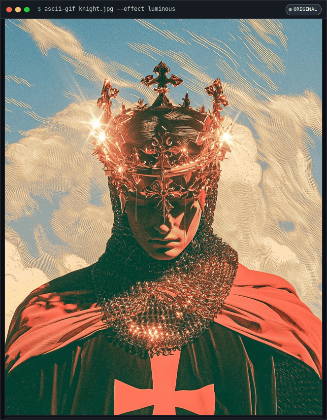

<div align="center">

# `image-to-ascii-gif`

**Convierte imágenes, GIFs y videos en arte ASCII animado con luz sutil, preservando el sujeto y los detalles.**

<p align="center">
  
  
  
  <a href="LICENSE"></a>
</p>

<br>



<p align="center">
  <sub>Generado directamente con <code>ascii-gif foto.jpg --showcase</code></sub>
</p>

</div>

---

## Características

- **Fiel al sujeto y al encuadre:** corrige automáticamente la proporción usando las métricas reales de la fuente monoespaciada y aplica un realce sutil de bordes para conservar rostros, siluetas y texturas.
- **Animaciones sutiles en bucle perfecto:** da vida a imágenes estáticas mediante barridos de luz, destellos en zonas brillantes (`luminous`, `shimmer`, `sweep`, `breathe`, `scanline`, `drift`) sin deformar la imagen.
- **Soporte multimedia completo:** acepta `PNG`, `JPG`, `WEBP`, `BMP`, `TIFF`, `GIF` animados y videos (`MP4`, `MOV`, `WEBM`, `MKV`, `AVI`).
- **Exportación lista para compartir:** genera automáticamente `PNG`, `GIF`, `MP4` (H.264) y `TXT` en `outputs/` sin modificar jamás el archivo original.
- **Modo Showcase integrado:** crea animaciones de transición *Original → barrido luminoso → ASCII animado* con `--showcase`, ideales para READMEs y redes sociales.
- **Renderizado rápido con atlas de glifos:** vectorizado con NumPy + Pillow y resplandor sutil configurable (`--glow`).

---

## Instalación

Requiere **Python 3.10 o superior**.

### Opción 1: Instalar directamente desde GitHub con [`uv`](https://docs.astral.sh/uv/) *(recomendado)*

```bash
uv tool install git+https://github.com/kingrxben/image-to-ascii-gif.git
```

Esto deja disponibles globalmente los comandos `ascii-gif` e `image-to-ascii-gif`.

> También puedes probarlo sin instalar nada de forma permanente:
> ```bash
> uvx --from git+https://github.com/kingrxben/image-to-ascii-gif.git ascii-gif tu_imagen.jpg
> ```

### Opción 2: Instalar con `pip`

```bash
pip install git+https://github.com/kingrxben/image-to-ascii-gif.git
```

### Opción 3: Clonar y ejecutar localmente

```bash
git clone https://github.com/kingrxben/image-to-ascii-gif.git
cd image-to-ascii-gif
uv sync
```

Con el repositorio clonado, ejecútalo así:

```bash
uv run ascii-gif ruta/a/tu_imagen.jpg
```

---

## Uso rápido

Procesa cualquier imagen con los valores predeterminados (`--detail high`, `--palette detailed`, `--color-mode color`, `--effect luminous`):

```bash
ascii-gif ruta/a/tu_imagen.jpg
```

Tu archivo original permanece intacto y los resultados se guardan en `outputs/`:

```text
outputs/
├── tu_imagen_ascii.png   # Fotograma clave en alta nitidez
├── tu_imagen_ascii.gif   # Animación en bucle perfecto
├── tu_imagen_ascii.mp4   # Video H.264 listo para redes
└── tu_imagen_ascii.txt   # Versión en texto plano
```

### Generar un GIF Showcase (*Antes → Después*)

Crea una animación como la portada de este README (imagen original → barrido de luz → arte ASCII animado en bucle):

```bash
ascii-gif ruta/a/tu_imagen.jpg --showcase-only --showcase-out assets/demo.gif
```

Si quieres exportar todos los formatos normales **y además** el GIF showcase:

```bash
ascii-gif ruta/a/tu_imagen.jpg --showcase
```

---

## Recetas y ejemplos

```bash
# Nombre personalizado para los archivos de salida
ascii-gif retrato.png --name caballero

# Estética terminal verde retro con barrido CRT
ascii-gif foto.jpg --color-mode green --effect scanline --palette matrix

# Estética ámbar vintage con destellos sutiles y movimiento lento
ascii-gif foto.webp --color-mode amber --effect shimmer --speed 0.7 --intensity 0.5

# Estilo tinta sobre papel con máximo detalle
ascii-gif retrato.jpg --color-mode paper --detail ultra --effect breathe --intensity 0.4

# Convertir un GIF animado o video a ASCII
ascii-gif clip.mp4 --width 110 --fps 12

# Usar una paleta de caracteres personalizada (de oscuro a claro)
ascii-gif foto.jpg --palette " .:-=+*#%@" --glow 0.3
```

---

## Opciones disponibles

| Opción | Predeterminado | Descripción |
| --- | --- | --- |
| `--name` | nombre del archivo | Nombre base para los archivos generados. |
| `-o`, `--output-dir` | `outputs` | Carpeta donde se guardan los archivos resultantes. |
| `--detail` | `high` | Nivel de detalle: `low`, `medium`, `high`, `ultra`. |
| `-w`, `--width` | según `--detail` | Ancho exacto en caracteres ASCII (ej. `90`, `140`). |
| `--palette` | `detailed` | Paleta: `detailed`, `classic`, `blocks`, `minimal`, `matrix` o cadena personalizada. |
| `--color-mode` | `color` | Modo de color: `color`, `amber`, `green`, `cyan`, `mono`, `paper`. |
| `--bg-color` | según modo | Color de fondo hexadecimal (ej. `#0a0c12`). |
| `--effect` | `luminous` | Efecto: `luminous`, `shimmer`, `sweep`, `breathe`, `scanline`, `drift`, `none`. |
| `--intensity` | `0.55` | Intensidad del efecto de luz/movimiento (`0.0` a `1.5`). |
| `--speed` | `1.0` | Multiplicador de velocidad (`0.5` más lento, `1.5` más rápido). |
| `--fps` / `--frames` | `12` / `24` | Fotogramas por segundo y cantidad de cuadros del bucle. |
| `--font-size` / `--font` | según `--detail` | Tamaño de fuente en píxeles o ruta a una fuente monoespaciada (`.ttf`/`.ttc`/`.otf`). |
| `--glow` | `0.22` | Resplandor sutil en fondos oscuros (`0.0` para desactivar). |
| `--contrast` / `--saturation` | `1.12` / `1.18` | Ajuste previo de contraste y saturación. |
| `--showcase` / `--showcase-only` | desactivado | Genera el GIF de transición *Original → ASCII animado*. |
| `--showcase-out` / `--showcase-cmd` | automático | Ruta de salida y texto de comando del GIF showcase. |
| `--no-png` / `--no-gif` / `--no-mp4` / `--no-txt` | todos activos | Permite omitir formatos específicos. |

### Referencia de efectos

- **`luminous`** *(predeterminado)*: barrido diagonal suave + destellos en zonas iluminadas + respiración ambiental.
- **`shimmer`**: centelleo orgánico sobre reflejos, brillos y bordes detallados.
- **`sweep`**: haz de luz limpio que recorre la composición en diagonal.
- **`breathe`**: pulsación suave de luz y profundidad tonal.
- **`scanline`**: banda luminosa horizontal estilo monitor CRT.
- **`drift`**: ondulación luminosa muy sutil sobre texturas sin deformar el sujeto.
- **`none`**: exportación estática sin animación.

---

## Licencia

Distribuido bajo la licencia **MIT**. Consulta el archivo [`LICENSE`](LICENSE) para más detalles.
